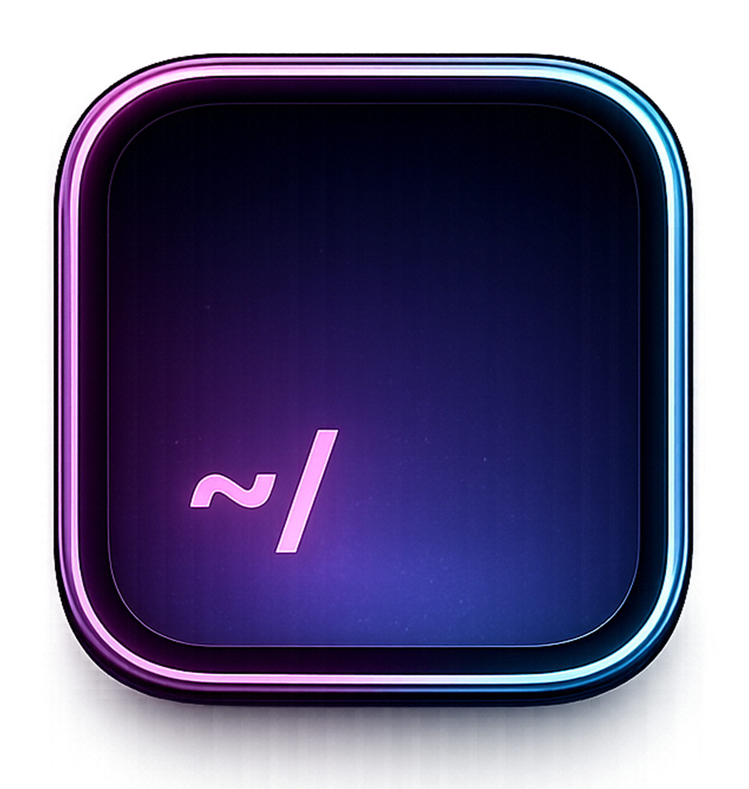

<div align="center">
  
</div>

<h1 align="center">agk-reborn</h1>

<p align="center">
  Multi-account manager for the Antigravity CLI (<code>agy</code>). Capture, switch and monitor Google accounts — CLI-only, no IDE required.
</p>

<p align="center">
  <a href="https://opensource.org/licenses/MIT">
    
  </a>
  = 18" />
</p>

> Reborn fork of [antigravity-kit](https://github.com/duongductrong/antigravity-kit), rebuilt for the modern Antigravity CLI authentication model. The original targeted the IDE (`~/.config/Antigravity`, `state.vscdb`, keychain) — this fork manages only the CLI credentials that live in `~/.gemini/`.

## Features

- **Capture current session** — snapshot whichever accounts are already logged into `~/.gemini`, no re-login needed
- **Account-per-file detection** — each auth file is attributed to its owner via JWT/email inspection, so mixed `~/.gemini` states split into the right profiles
- **Fast switching** — `agk auth switch` restores the target profile atomically and updates the active-account marker
- **Multi-client token refresh** — refresh tokens are bound to the OAuth client that issued them; agk-reborn knows the Antigravity, agy and Gemini CLI clients and remembers which one works per account
- **Quota monitoring** — live per-model quota (Claude, Gemini, …) with reset countdowns
- **Safe by default** — atomic file writes, 0600 permissions, automatic capture of the live session before every switch, warnings when `agy` processes are still running
- **Zero native dependencies** — no sqlite, no keytar, pure JS/TS

## Installation

```bash
npm install -g agk-reborn
# or
pnpm add -g agk-reborn
```

Or run from source:

```bash
git clone https://github.com/horizzon3507/agk-reborn
cd agk-reborn
pnpm install && pnpm build
node dist/cli.js --help
```

## Usage

```bash
agk auth add        # add an account: capture current session, browser OAuth, or paste a refresh token
agk auth list       # dashboard: saved accounts + live quota
agk auth switch     # switch accounts (interactive or `agk auth switch you@gmail.com`)
agk auth current    # show which account owns each live auth file
agk auth quota      # quota monitor for one account (`--once` for a single read)
agk auth remove     # delete a saved profile
agk doctor          # diagnose binary, auth files, profiles and running processes
```

### Typical workflow

```bash
# 1. Capture whatever is currently logged in
agk auth add        # choose "Capture current session"

# 2. Log in to another account in agy / gemini-cli, then capture again
agk auth add

# 3. Switch freely
agk auth switch inshigma@gmail.com
```

Restart running `agy` processes after switching — they hold credentials in memory. `agk` warns you when this is needed.

## How it works

The modern Antigravity CLI stores its session as JSON files under `~/.gemini/`:

| File | Contains |
| --- | --- |
| `antigravity-cli/antigravity-oauth-token` | agy access + refresh token |
| `antigravity-acp/acp_token.json` | ACP agent token |
| `oauth_creds.json` | shared OAuth credentials |
| `google_accounts.json` | active-account marker |

A profile is a snapshot of the auth files belonging to one account, stored under `~/.agk-reborn/profiles/<email>/` with `0600` permissions. Switching refreshes the stored token (using the OAuth client that issued it), writes the files back atomically, and sets the active marker.

Because refresh tokens only work with the OAuth client that issued them, agk-reborn tries every candidate client until one accepts the token, then records the winner in the profile so the next refresh is instant.

Candidates come from three places, in order:

1. The profile's recorded client (persisted after the first successful refresh)
2. Client credentials embedded in the captured auth files themselves (e.g. `acp_token.json` carries its own `client_id`/`client_secret`)
3. Runtime extraction from the installed `agy`/`antigravity`/`gemini` binaries (and their JS bundles)

## Security notes

- **No secrets in this repo** — OAuth client credentials are discovered at runtime from the local installation, never hardcoded
- Profiles live in `~/.agk-reborn` with restrictive permissions — they contain real refresh tokens; treat the directory as sensitive
- Tokens are never printed to the terminal or logs

## Credits

- Original project: [duongductrong/antigravity-kit](https://github.com/duongductrong/antigravity-kit) (MIT)
- Quota API approach based on the community's reverse engineering of the Cloud Code endpoints

## License

MIT — see [LICENSE.md](LICENSE.md).
